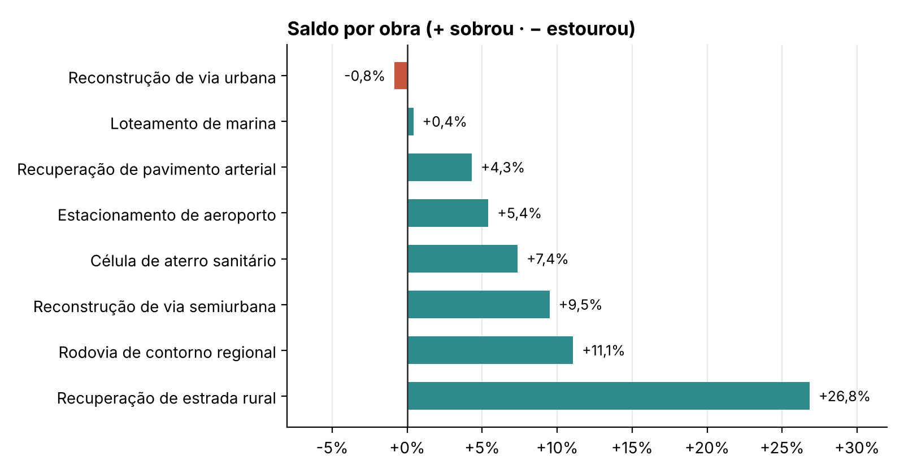
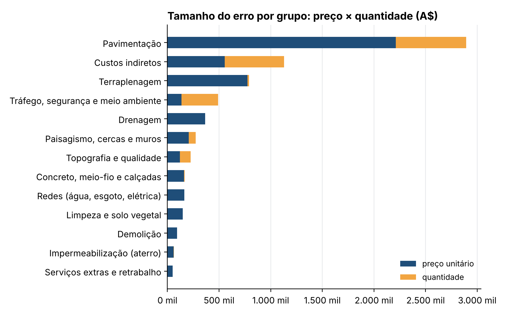
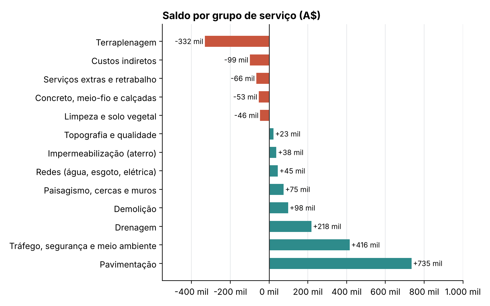

# Controle de custos de obra: o orçamento acertou?

Um diretor que olha só o resultado das 8 obras vê sucesso: 7 de 8 fecharam abaixo do orçado. Item por item, os números mostram o contrário.

**Resposta curta:** no fechamento, todo mundo comemora: as 8 obras gastaram 8% menos que o orçado. Mas, item a item, quase nada bateu: só 10 dos 265 itens ficaram a menos de 5% do previsto. Quase metade (46%) estourou, e poucas sobras grandes cobriram os estouros. O total só fechou bem porque um erro compensou o outro. A linha final engana; o problema aparece linha a linha. E cerca de 3/4 do erro veio do preço unitário, não da quantidade: **o orçamento não está aprendendo com as compras.**

**O que fazer:** levar o preço das compras fechadas de volta para o orçamento, a cada compra e não a cada obra; investigar o solo antes de orçar a terraplenagem; e avisar o comercial das propostas em andamento.

## Problema
Uma construtora fecha propostas com base na planilha de custos do orçamento. Se essa planilha não reflete o preço que compras paga de verdade, a empresa decide no escuro: o item que estoura come a margem sem ninguém ver, e o item que sobra (mesmo que por boa negociação) deixa a planilha errada para a próxima proposta. Vender a preço de custo, ou até abaixo, pode ser uma decisão comercial. O que não pode é decidir em cima de um custo que não existe.

**A pergunta:** a planilha de custos dessas 8 obras bateu com o que foi comprado? Onde não bateu, e por quê?

## Dados
- **Fonte:** [Project Portfolio Dataset (figshare)](https://figshare.com/articles/dataset/Project_Portfolio_Dataset/12998822), dados de uma construtora australiana de obras civis, publicados com um artigo científico. **Dados reais**, não sintéticos.
- 8 obras de infraestrutura concluídas em Queensland, Austrália (2011–2015). Valores em **dólar australiano (A\$)**.
- **3 tabelas limpas** (CSV, planilha em texto puro): `obras` (8), `itens` (265 serviços) e `evolucao_mensal`. Dicionário das colunas em [data/DICIONARIO.md](data/DICIONARIO.md).
- **Saldo = orçado − real**, como extrato de banco: positivo = sobrou, negativo = estourou.

## Abordagem
1. **Limpeza (Python):** 8 planilhas, cada uma num formato, viraram 3 tabelas. Conferência: a soma dos itens fecha com o acompanhamento mensal de cada obra.
2. **SQL:** 10 perguntas de negócio (GROUP BY, JOIN, HAVING, subconsulta e window functions).
3. **Python:** gráficos de saldo por obra e por grupo, preço × quantidade e mapa obra × grupo.
4. **Power BI:** dashboard de diretoria.

**Decisões que tomei:**
- **Tolerância zero:** qualquer real acima do orçado é estouro. Era a regra que eu vivia em suprimentos: o diretor cortava 20% da planilha de custos e a compra tinha que caber.
- **Separei o erro em quantidade e preço:** fez a mais ou pagou mais caro? São problemas diferentes, com responsáveis diferentes.
- **Descartei os lançamentos de custo** (não fecham com o custo final) **e a receita** (subtotais misturados com totais). A análise é de custo, não de lucro.

## Resultados
| Pergunta | Resultado |
|---|---|
| As 8 obras somadas | Orçado A\$ 12,6 mi · real A\$ 11,6 mi · **sobrou 8,3%** |
| Obras que estouraram | Só 1 de 8 (via urbana, 0,8% acima); a estrada rural sobrou 26,8% |
| Itens acima do orçado | **122 de 265 (46%):** 92 estouraram e 30 nem estavam no orçamento |
| O que o total esconde | Estouros de **A\$ 2,3 mi** compensados por sobras de **A\$ 3,4 mi** |
| Maior estouro | **Terraplenagem: A\$ 332 mil (24% acima do orçado)** |
| Maior sobra | Pavimentação: A\$ 735 mil (15% abaixo); tráfego gastou só um terço do previsto |
| Preço ou quantidade | **Cerca de 3/4 do erro veio do preço unitário** |
| Não orçados | 30 itens, A\$ 175 mil (chuva, retrabalho, EPI...) |

## Conclusão
**O orçamento não está aprendendo com as compras.** Nas 8 obras, o preço orçado não bateu com o preço pago, para mais e para menos, e cerca de 3/4 do erro veio daí, não da quantidade. O total só fechou bem porque um erro compensou o outro.

Pode apertar o preço de venda para fechar o negócio. O que não pode é mentir o custo: na hora de comprar, o preço é o do mercado.

**Possíveis causas** (da minha experiência em suprimentos; estes dados não mostram o motivo):
- composições desatualizadas em relação ao preço de mercado
- desconto para o cliente aplicado dentro dos itens, apertando o custo para chegar no valor de venda
- fornecedor mais barato no orçamento, depois reprovado pela obra

**Dois tipos de erro, duas respostas:**
- **Erro repetido** (tráfego e pavimentação sobram quase sempre): retroalimentação rápida de compras para o orçamento, a cada compra fechada, e não a cada obra.
- **Erro imprevisível** (terraplenagem estoura em 3 obras e sobra em 2): o problema é a informação sobre o solo. A resposta é investigar antes ou colocar o risco no preço.

## Com os dados da sua empresa
Esta análise usa dados públicos. Com o histórico de uma construtora (orçamentos, pedidos de compra e medições), eu consigo:
- mostrar quais composições estão desatualizadas e quanto isso pesa em cada proposta
- medir quanto tempo a planilha de custos leva para refletir o preço de compra
- separar o erro repetido (corrigir a composição) do erro imprevisível (colocar o risco no preço)
- cruzar os estouros de terraplenagem com as sondagens de cada obra

**Próximo passo com estes dados:** projetar o custo final de cada obra durante a execução, com o acompanhamento mensal (`evolucao_mensal.csv`).

## Tecnologias
Python (pandas, matplotlib, openpyxl) · SQL (SQLite) · Power BI · Google Colab · IA como copiloto (Claude)

## Como rodar
1. Baixe este repositório (os dados limpos já estão em `data/`).
2. Abra os notebooks no Google Colab, suba a pasta `data/` e rode tudo.
3. Para refazer a limpeza: baixe o dataset do figshare e rode `limpeza/extract_obras.py` e depois `limpeza/clean_obras.py`.

**Dashboard:** abra `powerbi/construction_cost_dashboard.pbip` no Power BI Desktop e aponte o parâmetro `PastaDados` para a pasta `data/` (passo a passo em `powerbi/COMO_ABRIR.md`).

---
*Construído com apoio de IA; a pergunta de negócio, as decisões e as conclusões são minhas.*
